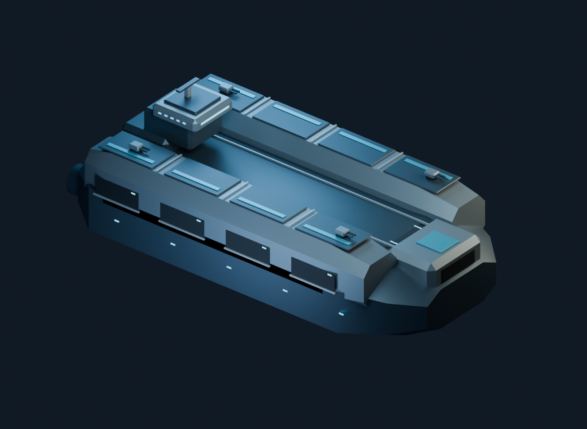
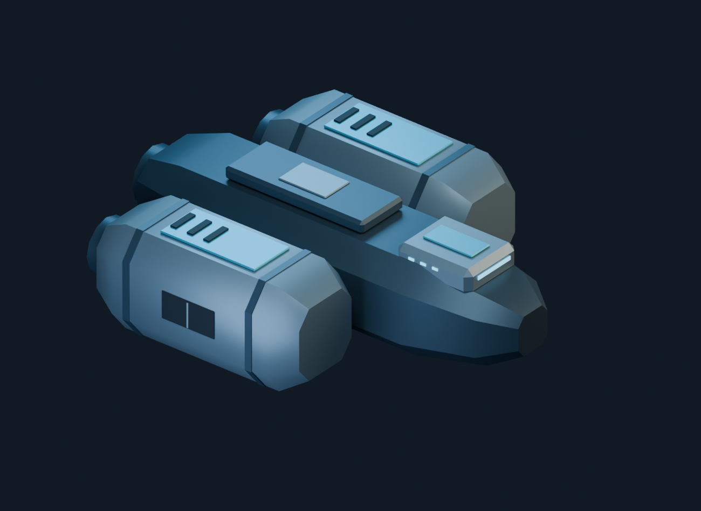
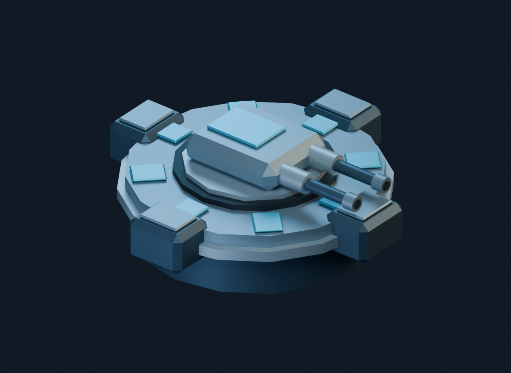

# 3D fleet exploration

Static model studies for a possible isometric 3D version of the game. This branch contains assets and authoring sources; it does not switch the game renderer or load the models at runtime.

- [Approved normal warship](capital-ship-3d/v3/README.md): narrowed volumetric hull, deep armor and raised bridge. This is the higher-detail style reference (30,608 triangles).
- [Low-poly fleet](fleet-3d/README.md): carrier (3,952 triangles), troop transport (1,412), and orbital defense platform (1,552).

Each model has an editable Blender source, self-contained GLB, authoring script, preview renders and validation evidence. Binary files are small enough to track directly in Git; Git LFS is not required for this set. ZIP downloads, Blender backups, raw exports and superseded local warship studies are ignored.

Open a `.blend` file to inspect or edit an asset. To rebuild, open its saved Python script in Blender's Scripting workspace and run it; output paths resolve relative to that script. Each script creates new scenes without clearing existing ones. The model README files explain the separate glTF optimization step.

Models face +X; up is Blender +Z / glTF +Y. Scale is provisional. GLB meshes are static, and runtime LODs, collision, turret animation, fleet instancing and performance remain future work. The warship's visual direction was accepted during exploration; that does not constitute gameplay acceptance or approval of an engine migration.
