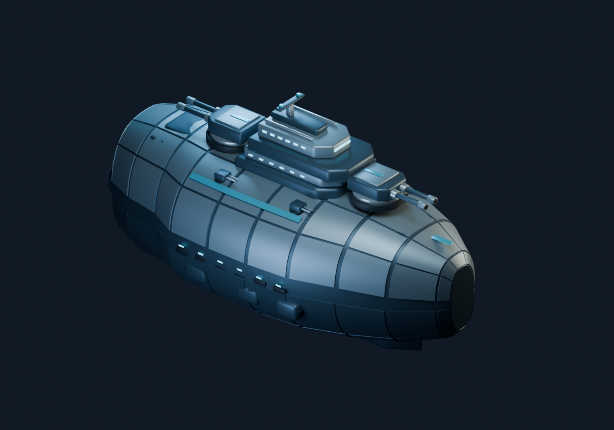

# Narrower warship study (v3)

Hull beam reduced by 16% from v2. Length and vertical volume are preserved. The bridge and armor narrow with the hull; gun mounts, point defenses, sensors, and engine hardware retain their local dimensions while mounting positions follow the narrower beam.

`capital-warship.blend` is editable; `capital-warship.glb` is the optimized static export. `isometric.png`, `aft.png`, and `profile.png` are model renders with the same cameras as v2. Earlier local studies are excluded from Git.

Run `build_ship.py` in Blender to regenerate the source, then optimize its raw GLB from this directory:

```sh
bun x @gltf-transform/cli@4.5.1 optimize capital-warship.raw.glb capital-warship.glb --compress false --simplify false --texture-compress false --instance false --palette false
```

No game integration or movement changes. Project typecheck passed; export validation is recorded in `validation.json`.


